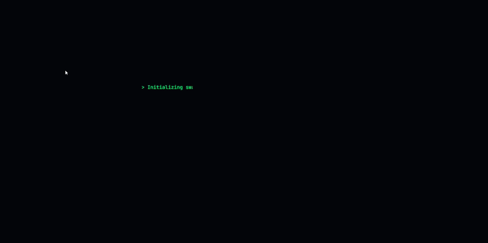

# Coloss-AI - Press one button and create a whole infrastructure department

> Type 'up' in your terminal, press enter, and watch the magic unfold.

What do you get?
- Kubernetes Cluster via Minikube
- ArgoCD and Gitops
- Erlang backend for LLM messaging
- OpenWebUI for chat all hooked up to the backend
- Ollama for AI serving
- Haskell MCP server for K8S API read access
- Dashboard in Elixir to read Erlang and LLM telemetry



[](flake.nix)
[](helm/)
[](#subsystems)

---
## Quickstart

### Prerequisites
* Nix package manager with flakes enabled (`experimental-features = nix-command flakes`).
* Docker / Minikube container runtime.

### Getting Started
```bash
# 1. Enter the hermetic environment
nix develop

# 2. Format configuration (Alejandra)
nix fmt .

# 3. Bootstrap the cluster, local Gitea instance, and GitOps sync - why `up`? Custom shell command defined via Nix that runs all the setup
up
```
## System Architecture

```text
+-------------------------------------------------------------------------------------------------------------+
|                                             Developer Workspace                                             |
|                                    ( nix develop  |  Host Web Browser )                                     |
+-------------------------------------------------------------------------------------------------------------+
       |                                                                               ^
       |                                                                               | (Browser Access)
       v                                                                               |
+--------------------------------------------------------------------------------------|----------------------+
|                                        Host OS & Deterministic Layer                 |                      |
|                                                                                      |                      |
|   [ Flake Environment ] --- (Compiles Helm to Static Manifests) --+                  |                      |
+-------------------------------------------------------------------|------------------|----------------------+
                                                                    |                  |
                                                                    | (Git)            |
                                                                    v                  |
+-----------------------------------------------------------------------+              |
|                             Git Repository                            |              |
|                                                                       |              |
|                            [ Gitea Server ]                           |              |
+-----------------------------------------------------------------------+              |
                                    |                                                  |
                                    | (GitOps Sync / Root App-of-Apps)                 |
                                    v                                                  |
+======================================================================================|======================+
|                                             Kubernetes Cluster                       |                      |
|                                                                                      |                      |
|  +-----------------------------------------------------------------------------------|-------------------+  |
|  | Host Port Exposure / Ingress Layer                                                |                   |  |
|  |     ArgoCD UI:            localhost:8888  <---------------------------------------+                   |  |
|  |     OpenWebUI Chat:       localhost:9000  <---------------------------------------+                   |  |
|  |     Telemetry Dashboard:  localhost:4000  <---------------------------------------+                   |  |
|  +-------------------------------------------------------------------------------------------------------+  |
|       ^                                                                                                     |
|       |                                                                                                     |
|  +----|-----------------+                                                                                   |
|  | GitOps Control Plane |                                                                                   |
|  | [ ArgoCD Server/App ]|                                                                                   |
|  | (:8888)              |                                                                                   |
|  +----------|-----------+                                                                                   |
|             |                                                                                               |
|             |==================== (Reconciles & Manages All Workloads / CRDs) ====================+         |
|             |                     |                              |                                |         |
|             v                     v                              v                                v         |
|  +---------------------+  +-------------------+        +-----------------+              +----------------+  |
|  | Host Exposure Layer |  | Application Tier  |        | Dashboard Tier  |              | Inference Tier |  |
|  | [ Ingress / Ports ] |  | [ OpenWebUI ]     |        | [ Elixir Dash ] |              | [ Ollama+GPU ] |  |
|  |                     |  | (:9000)           |        | (:4000)         |              | (:11434)       |  |
|  +---------------------+  +---------|---------+        +--------^--------+              +--------^-------+  |
|                                     |                           |                                |          |
|                                     | (Chat Requests)           | (Reads RPC / Telemetry)        |          |
|                                     v                           |                                |          |
|                           +-------------------+                 |                                |          |
|                           | Agent Tier        | ----------------+                                |          |
|                           | [ Don Erleone ]   |                                                  |          |
|                           | (BEAM / OTP)      | -------------------------(Inference)-------------+          |
|                           +---------|---------+                                                             |
|                                     |                                                                       |
|                                     | (Tool Execution)                                                      |
|                                     v                                                                       |
|                           +-------------------+                                                             |
|                           | [ MCP Server ]    |                                                             |
|                           | (Haskell)         |                                                             |
|                           +---------|---------+                                                             |
|                                     | (K8s API Queries)                                                     |
|                                     v                                                                       |
|                           +------------------------------------------------------+                          |
|                           |                Kubernetes Cluster API                |                          |
|                           +------------------------------------------------------+                          |
+=============================================================================================================++
```
---
## Key Architecture Decisions

### 1. Deterministic Toolchains & Schema Validation (Nix & Haskell)
- **Hermetic Environment (`flake.nix`):** Ensures bit-for-bit reproducibility across local development machines, pinning CLI toolchains, Helm release compilers, and formatting tools.
- **Type-Safe Tool Gateway (Haskell MCP):** Writing directly to the Kubernetes API requires strict boundary safety. Haskell’s static type system enforces compile-time schema validation over raw JSON-RPC payloads before any state-mutating requests reach `kube-apiserver`.

### 2. Failure Isolation & Concurrency (Erlang/OTP & Elixir)
- **Fault-Tolerant Agent Loops:** LLM token streams and dynamic tool executions are inherently non-deterministic and prone to network stalls. Erlang/OTP supervisor trees isolate long-running agent workflows so that an unhandled timeout or upstream socket drop restarts an isolated worker process without crashing the session state.
- **Cross-Service Telemetry:** The BEAM allows frictionless RPC communication between the Erlang agent runtime and the Elixir dashboard, avoiding the need for heavy local telemetry collectors during initial development.

### 3. Local GitOps Loop (Gitea + ArgoCD vs. `kubectl apply`)
- **Realistic Reconciliation Testing:** Validating automated GitOps workflows requires an actual remote repository to simulate commits, sync loops, and automated reconciliation without pushing proprietary or experimental manifests to a public remote.
- **Isolated Control Plane:** Running Gitea directly alongside the cluster isolates the manifest delivery pipeline entirely within the local testbed.

---

## Technical Trade-Offs & Architectural Friction

- **Orchestration Overlap (K8s vs. BEAM):** Running Erlang clustering inside Kubernetes introduces competing responsibilities: Kubernetes manages pod lifecycle and container networking, while the BEAM manages internal node discovery and actor distribution. In production, this duel of orchestration layers can lead to split-brain scenarios or redundant health checks.
- **BEAM Flat Module Namespace & In-VM Trust Boundaries:** The BEAM provides crash and heap isolation, not security sandboxing. All exported functions across loaded modules are globally addressable within the VM. To mitigate arbitrary execution risks from agent tool calls, security isolation is strictly delegated outward to Kubernetes pod/namespace boundaries rather than relying on in-VM multi-tenancy.
- **Developer Onboarding & Tooling Friction:** 
  - **Nix & Haskell:** Provide mathematically sound guarantees and reproducible environments, but carry steep onboarding curves, slow cold-cache build times, and fragmented ecosystem libraries for cloud orchestration.
  - **Memory Safety in Haskell:** Care is required to prevent space leaks caused by lazy evaluation and unreduced thunks in long-running streaming loops.

---

## Practical Findings: The Limits of LLM-Assisted Systems Engineering

This project was used as a testbed to evaluate where LLM coding assistants fail when building distributed infrastructure:

1. **Failure on Niche Language Semantics (Erlang & Nix):** 
   - LLMs struggled with Erlang’s binary pattern matching. Copilot and Opus routinely hallucinated broken implementations of HTTP chunked Server-Sent Events (SSE) from the Ollama `/chat` endpoint via `gun`. They failed to account for partial TCP packet fragmentation (`<<...>>`), requiring manual tail-recursive byte buffers to correctly slice incoming JSON frames.
   - LLMs systematically generated invalid or overly verbose Nix code, frequently requiring manual refactoring from scratch rather than agentic debugging loops.
2. **Idiomatic Code Quality (Anti-Patterns):**
   - In Erlang, models defaulted to 100+ line nested `case/switch` blocks rather than idiomatic function-head pattern matching and multi-clause guards.
3. **Macro-Architecture & Boundary Blindness:**
   - LLMs were incapable of reasoning about multi-service directory structures, Helm chart hierarchies, or network trust boundaries. Architecture and topology had to be authored by hand before any agentic workflow could produce functional code.

> **Takeaway:** LLMs accelerate boilerplate generation, but they lack architectural taste, struggle with non-mainstream language paradigms, and fail at complex network boundary conditions. Rigorous human system design remains essential.

---
# Key Architectural Details

* **Exact, Reproducible Environments:**  
  No more "it works on my machine!". If you have Nix, you have Flakes, you run this thing, it works. Badda bing badda boom.
* **Air-Gapped GitOps Reconciliation:**  
  Helm charts are compiled into static manifests and synced to an in-cluster Gitea instance. ArgoCD tracks Gitea via declarative `ApplicationSet` definitions, and uses it as a local cluster level reconciler of state. This leads the way to great push-based scalability the more clusters you have within your fleet. 
* **Large Scale, Resilient Concurrency (BEAM):**  
  The AI/LLM backend messaging and routing layer (`Don Erleone`) leverages Erlang/OTP supervisor trees to isolate long-running agent workflows, retry states, and dynamic tool orchestration from network and pod failures. Basically, imagine a technology that is used specifically to power telecommunications used for your LLM messaging streams.
* **Type-Safe Model Context Protocol (MCP):**  
  Cluster inspection and tool boundaries are created with a custom Haskell MCP service, enforcing strict compile-time guarantees and deterministic validation over Kubernetes API interactions. This means that if it's proved to work once within Haskell, it will work forever. Mathematically provable and true to the end of days.
* **Zero-Egress Accelerated Inference:**  
  Local LLMs are served via an in-cluster Ollama deployment backed by container-level NVIDIA GPU passthrough.
  Setting up LLM and NVIDIA CUDA drivers is painful, but this setup does it for you.
---

## Subsystem Breakdown

| Tier | Primary Technologies | Architectural Role |
| :--- | :--- | :--- |
| **Tooling & Host Layer** | Nix Flakes, Justfile | 1-to-1 reproducible developer shell, pinned dependencies, deterministic code artifacts. |
| **Cluster Engine** | Minikube, Kubelet | Mirror your cloud setup locally, enabling faster testing and development parity |
| **GitOps Control Plane** | ArgoCD, Gitea, Helm | Declarative continuous delivery, auto-reconciliation, and drift correction. |
| **Agent Engine** | Erlang / OTP | Resilient actor model managing dynamic state machines, recursive tasks, and backoffs. |
| **Tool Execution** | Haskell (MCP) | Type-safe execution protocol querying the K8s API directly. |
| **Inference Layer** | Ollama, OpenWebUI | Local GPU-accelerated weights serving low-latency model evaluations. |

---

## Low-Level Operational Notes & Edge Case Findings

<details>
<summary><strong>Hardware-Level GPU Passthrough & Container Toolkit Configuration</strong></summary>

### NVIDIA Container Toolkit Runtime Patch
Ensure the Docker daemon is configured to expose the NVIDIA runtime:
```bash
sudo nvidia-ctk runtime configure --runtime=docker && sudo systemctl restart docker
```

### WSL2 Node Feature Discovery (NFD) Manual RBAC
When utilizing subcharts where parent RBAC bindings are dropped, apply the standalone service account configuration:
```yaml
# values.yaml
node-feature-discovery:
  serviceAccountName: "node-feature-discovery"
```

Manual cluster role and node labeling override:
```bash
kubectl label node sandbox-cluster-control-plane [nvidia.com/gpu.deploy.container-toolkit=true](https://nvidia.com/gpu.deploy.container-toolkit=true) --overwrite
kubectl label node sandbox-cluster-control-plane [nvidia.com/gpu.present=true](https://nvidia.com/gpu.present=true) --overwrite

# Patch NFD master node-feature exclusion if required
kubectl patch deployment gpu-operator-node-feature-discovery-master -n gpu-operator \
  --type='json' -p='[{"op": "add", "path": "/spec/template/spec/containers/0/args/-", "value": "--deny-node-feature-group=nvidia.com"}]'
```

### GPU Operator Stuck Finalizer Recovery
If tearing down or rebuilding operator namespaces with hanging finalizers:
```bash
kubectl delete clusterrolebinding gpu-operator-node-feature-discovery-prune
kubectl delete clusterrole gpu-operator-node-feature-discovery-prune
kubectl patch app infra-gpu-operator -n argocd \
  --type merge \
  -p '{"metadata":{"finalizers":null}}'
```
</details>

<details>
<summary><strong>ArgoCD ApplicationSet Resource Management</strong></summary>

To prevent resource exhaustion when running the full stack on constrained local nodes, selectively exclude heavy monitoring or database charts via `appsets.yaml`:

```yaml
kind: ApplicationSet
metadata:
  name: my-cluster-apps
spec:
  generators:
    - git:
        repoURL: [https://github.com/your-org/infra-repo.git](https://github.com/your-org/infra-repo.git)
        revision: HEAD
        directories:
          - path: apps/*
          # Exclude resource-intensive stacks locally
          - path: apps/heavy-stack-prometheus
            exclude: true
          - path: apps/resource-hog-db
            exclude: true
```
</details>

<details>
<summary><strong>Local In-Cluster Service Verification</strong></summary>

Verify connectivity between OpenWebUI and internal Ollama instances:
```bash
# Verify internal cluster DNS and model tag resolution
kubectl exec -it -n open-webui deploy/open-webui -- \
  curl [http://ollama-internal.ollama.svc.cluster.local:11434/api/tags](http://ollama-internal.ollama.svc.cluster.local:11434/api/tags)
```
</details>
